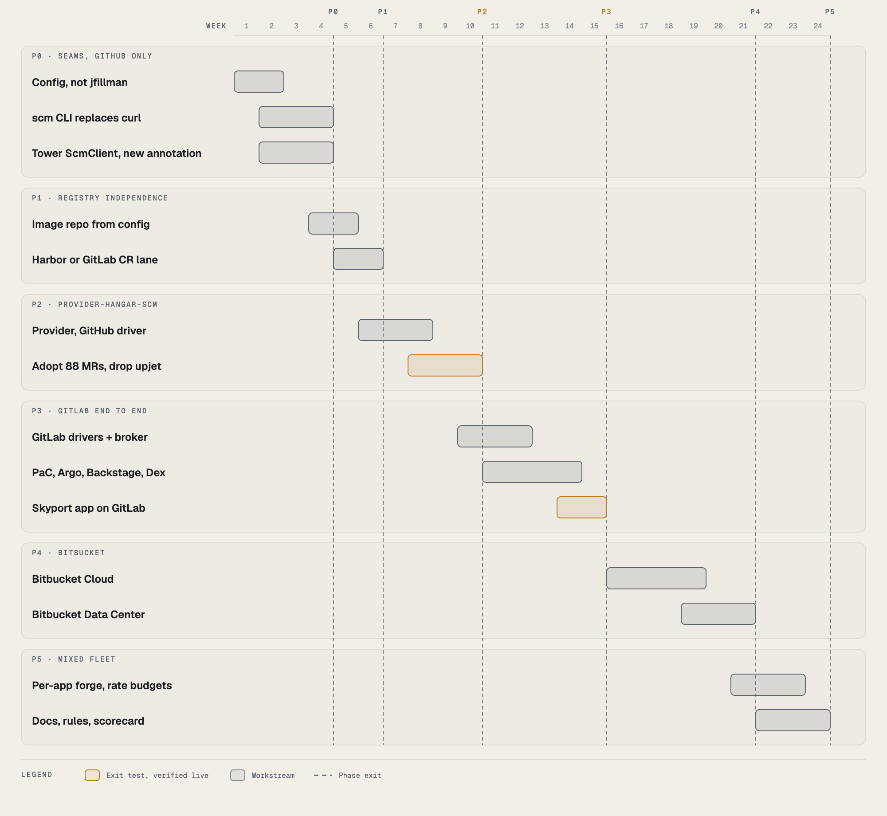

# Any forge, any registry

**Status: proposal, for decision (2026-10-15). Nothing here is built.**

A plan to run Hangar on GitLab and Bitbucket as well as GitHub, and to publish images to any OCI registry as well as
GHCR, without changing what Hangar is. The illustrated version, with the same content, is
[in the Library](https://hangarplatform.dev/library/forge-registry-portability/); the six one-page diagrams are in [`diagrams/`](diagrams/) and in the
[diagram gallery](https://hangarplatform.dev/diagrams/#portability).

## Verdict

Feasible, in six phases, about 24 weeks for one person. Tekton, Pipelines as Code, Argo CD, External Secrets,
Crossplane and cosign already work with GitLab and Bitbucket. GitHub is wired in at about a hundred small places
(a literal owner, a `curl` to `api.github.com`, a hardcoded link) and at three load-bearing ones:

1. **The control plane writes to repositories through provider-upjet-github**: 81 templates in 9 compositions, 88 live
   resources on the dev cluster (24 Repository, 64 RepositoryFile). provider-gitlab has no file resource, there is no
   maintained Bitbucket Cloud provider, and this provider caused the September data loss and rate-limit storms.
2. **CI tokens are GitHub App installation tokens.** The never-persisted credential model is built on a GitHub feature
   GitLab and Bitbucket do not have in the same form.
3. **An app is identified by `github.com/project-slug`.** Tower authorization (ACC-05), release approvers and the catalog
   app list key on it, and its `split('/')` assumes a one-segment owner that GitLab subgroups break.

**Recommendation:** two Hangar-owned contracts, SCM and registry, with each vendor as a driver. Move the GitHub path
onto them first with no visible change (phases 0 to 2, which also removes the RepositoryFile bug class), then GitLab as
the proof (phase 3), then Bitbucket (phase 4). The forge and the registry become separate choices: Bitbucket has no
registry of its own.

## What is coupled today

| Where | Coupling | Evidence | Kind |
|---|---|---|---|
| Airframe | Repos and files are `repo.github.m.upbound.io` Repository and RepositoryFile | `compositions/*/templates/render-github-resources/` | load-bearing |
| Airframe | Owner literal; repo URLs and Go module path built as `github.com/<owner>/<app>` | `$platformOwner := "jfillman"` (10 places), `goapplication` | mechanical |
| Airframe | Container App registry defaults to `ghcr.io` | `xrds/azurecontainerapptarget.yaml` | mechanical |
| Glidepath | 13 Tasks, 1 StepAction and the preview notify Job call `api.github.com` with `curl` | `open-release-pr`, `comment-pr-check-result`, `deliver-onboarding-files`, `verify-commit-signature`, ... | mechanical, wide |
| Glidepath | Broker mints GitHub App installation tokens | `token-review-interceptor` `/github-installation-token`, `catalog/lib/github-app.sh` | load-bearing |
| Glidepath | Image path derived from the GitHub owner | `deliver-onboarding-files.yaml` `image_repo="ghcr.io/${GITHUB_OWNER}/${APP_NAME}"`; previews `-pr` | mechanical |
| Glidepath | Merge gate is a GitHub ruleset trusting the PaC app's checks | `docs/admin/github-ruleset.md` | policy |
| Tower | App identity is `github.com/project-slug` | `towerAuthz.ts`, `releaseApprovers.ts`, `catalogApps.ts`, `TowerPage.tsx` | load-bearing |
| Tower | GHCR-only image client; prune and Images tab on the GitHub Packages API | `ghcr.ts`, `imagePrune.ts`, `classifyGhcrVersion` | mechanical |
| Tower | Links hardcoded to `https://github.com/` | `activityRowRenderers.tsx`, `useEnvLifecycle.ts` and 6 more | mechanical |
| Backstage | GitHub OAuth sign-in, only `integrations.github`, ingestor `publishPhase.target: github` | `app-config*.yaml` | policy |
| Apron | Argo CD repo creds are GitHub App creds for `https://github.com/jfillman`; ApplicationSet allows only `https://api.github.com` | `01-argocd-platform/repo-creds/`, `argocd-apps-install` | mechanical |
| Autopilot | Agent images on `ghcr.io/jfillman` | `agents/*.yaml` | mechanical |

Already neutral: Tekton and Pipelines as Code (GitLab, Bitbucket Cloud and Data Center are supported providers), Argo CD,
the `registry-credentials` ClusterExternalSecret, cosign and Rekor, Apron's `scm.host`/`scm.owner`, and the terasky
ingestor's publish step (`gitlab`, `bitbucket`, `bitbucketcloud` targets, checked in the installed source).

## Principles

- **Separate the forge from the registry.** The image path comes from registry config, never from the forge owner.
- **Hangar names things.** `scm.hangar.io` resources, `hangar.io/app` identity, an `scm` CLI. Vendors are drivers.
- **GitHub moves first.** Nothing reaches GitLab until GitHub runs on the contracts with no visible change.
- **Capabilities, not the lowest common denominator.** A driver declares what it can enforce; Tower shows the real level.
- **Write the credential delta down.** Weaker is allowed; silent is not.
- **Adopt, never recreate.** Every migration step observes existing repos by name and may neither commit nor delete.

## Target architecture

**SCM contract**, one Go library with three faces:

- **Declarative**: `provider-hangar-scm`, a native Crossplane provider serving `scm.hangar.io/v1alpha1` `Repository`,
  `RepositoryFile`, `Webhook` and `MergeGate`. A ProviderConfig per forge picks the driver, so compositions keep one
  shape. `RepositoryFile.spec.mode` is `seed` (create once if absent, never update or delete) or `managed` (the
  tenants-repo identity files).
- **Imperative**: an `scm` CLI in the Glidepath toolbox image (`scm pr open|find|comment`, `scm status`,
  `scm contents get`, `scm compare`, `scm pr-for-commit`, `scm gate apply`) replacing the inline `curl`, and a broker
  endpoint `/scm-token` beside `/github-installation-token`.
- **Tower**: a TypeScript `ScmClient` and `RegistryClient` in the Backstage backend, drivers on `@backstage/integration`
  (which already handles GitLab, Bitbucket Cloud and Bitbucket Server credentials), run against the same recorded
  conformance fixtures.

**Registry contract**: plain OCI for push, pull, digest, tags, referrers and cosign, with the standard bearer
challenge instead of `ghcr.ts`'s GHCR token exchange. Drivers only for listing with dates and deleting. Config:
`registry.host`, `registry.namespace`; image path `<host>/<namespace>/<app>`, previews `-pr`.

**Identity**: `hangar.io/app`, `hangar.io/forge`, `hangar.io/source-location`. Tower authorization reads
`hangar.io/app`. Namespaces may have several segments (GitLab subgroups, Bitbucket workspace and project).

**Sign-in**: OIDC through Dex (already in the cluster; GitHub, GitLab and Bitbucket Cloud connectors), users still
matched to catalog Users.

### Decision: how the control plane writes to a forge

| Option | For | Against |
|---|---|---|
| A. A vendor provider per forge | No new code for GitHub and GitLab | No GitLab file resource, no maintained Bitbucket Cloud provider, three composition variants, keeps the RepositoryFile bugs |
| B. File writes move into Glidepath | No reconciler writing to repos | Loses continuous reconcile for tenants identity files; Airframe would need Glidepath to scaffold |
| **C. provider-hangar-scm (recommended)** | One behaviour everywhere; compositions change only apiVersion and providerConfigRef; 404-only-means-gone, observed external-name, no write on adopt | Hangar owns a Go provider, about 4 weeks with the GitHub driver |

## The SCM contract, operation by operation

| Operation | Caller | GitHub | GitLab | Bitbucket Cloud | Bitbucket DC |
|---|---|---|---|---|---|
| Repository | Airframe | repos | projects | repositories | projects/repos |
| Seed or manage a file | Airframe | contents PUT | commits with actions | src POST | browse PUT |
| Webhook | Airframe | none (app-level) | project hook | repo webhook | repo webhook |
| Merge gate | Apron, Glidepath | ruleset, checks by app | protected branch, pipelines must succeed, approval rules | branch restrictions, merge checks | branch permissions, required builds |
| Open, find, update PR | Glidepath, Tower | pulls | merge_requests | pullrequests | pull-requests |
| Upsert a comment | Glidepath | issue comments | MR notes | PR comments | PR comments |
| Status per gate | PaC, Glidepath | check runs | commit statuses | build statuses | build statuses |
| Read a file at a ref | Glidepath, Tower | contents | files raw | src | raw |
| Compare, PR for a commit | Glidepath, Tower | compare, commits/pulls | compare, commits/merge_requests | diffstat, commit/pullrequests | compare |
| Short-lived token | Broker | App installation, 1 h | project access token, by date | OAuth client credentials, 2 h | repo HTTP token, by days |

Check each endpoint against the vendor reference when its driver is written; the Data Center column is unverified.

## The registry contract

| Capability | Standard | GHCR | GitLab CR | Harbor | ECR |
|---|---|---|---|---|---|
| Push, pull, digest, tags | OCI Distribution | same code | same code | same code | same code |
| Auth | bearer challenge | PAT for a token | deploy or CI token for a JWT | robot account | 12 h login token |
| cosign signatures | tag or referrers | tag | tag | tag and referrers | tag and referrers |
| List versions with dates | vendor | GitHub Packages API | registry API | Harbor API | DescribeImages |
| Delete | vendor | Packages API, classic PAT | registry API | Harbor API | BatchDeleteImage |
| Retention | vendor | none; Tower prunes | cleanup policies | retention rules | lifecycle policies |

A Bitbucket fleet must pick a registry. Harbor is the recommended neutral default.

## Credentials, forge by forge

| Path | GitHub | GitLab | Bitbucket Cloud | Bitbucket DC |
|---|---|---|---|---|
| CI write token | App installation, 1 h, one repo | project access token, expires next day, revoked at run end | OAuth client credentials, 2 h, **whole workspace** | repo HTTP token, 1 day |
| PaC trigger and status | GitHub App, nothing stored | token Secret on the Repository CR, rotated daily | same | same |
| Control plane | GitHub App (ends the shared PAT bucket) | group access token | workspace access token | project HTTP token |
| Argo CD, read only | GitHub App repo creds | group deploy token | workspace access token | project HTTP token |
| Tower backend | GitHub App (a PAT today) | group access token | workspace access token | HTTP token |

Bitbucket Cloud removed app passwords on 2026-07-28. Plan tiers change what can be enforced; check vendor pricing
before choosing a lab plan.

## The proof: one release on GitLab

## What changes, product by product

- **Airframe**: `scm.hangar.io` replaces `repo.github.m.upbound.io` (the `_shared` partials keep the diff small); owner,
  host and registry from the cluster registry entry; optional `spec.source` on app XRDs; a `Webhook` per repo off GitHub;
  the Go module path follows the source host.
- **Glidepath**: the `scm` CLI replaces `curl`, one Task per PR (ADR-0026, the SCM contract);
  `platformIdentity.githubOwner` becomes `platformIdentity.source`; `image-repo` from registry config; `/scm-token` and
  the PaC secret rotator; `github-ruleset.md` becomes `merge-gate.md`, rendered by `scm gate apply`.
- **Tower and Backstage**: `ScmClient` and `RegistryClient`, with today's GitHub code as the first driver; authorization
  and approvers read `hangar.io/app`; integrations, scaffolder publish and ingestor target per forge; sign-in through Dex;
  each app shows its forge and merge-gate level.
- **Apron, Autopilot, Hangar**: `cluster.yaml` gains `scm.forge`, `scm.namespace`, `registry.*`; provider-github removed
  after phase 2; agent images from registry config; business rules PPL-01, PPL-02, ACC-05, GATE-03 and GATE-06
  reworded per forge as each lands ([business rules](../policy/business-rules.md)).

## Moving the GitHub fleet first

## Roadmap

| Phase | Weeks | Exit, verified live |
|---|---|---|
| P0 Seams, GitHub only | 1-4 | No `api.github.com`/`ghcr.io` literal outside a driver (CI ratchet); no owner literal; Tower reads `hangar.io/app`; a Skyport release and rollback unchanged; GitHub calls per hour at or below baseline |
| P1 Registry independence | 4-6 | One Skyport app builds, signs, passes provenance, deploys, lists and prunes from a non-GHCR registry |
| P2 provider-hangar-scm | 6-10 | All 88 resources adopted with zero commits; provider-upjet-github uninstalled; an injected 403 neither deletes nor rewrites a file |
| P3 GitLab end to end | 10-15 | The GitLab sequence runs with a rollback; the merge gate refuses a red gate; broker tokens revoked after each run |
| P4 Bitbucket | 16-21 | The P3 test on Bitbucket Cloud with Harbor, then Data Center |
| P5 Mixed fleet | 21-24 | One fleet with apps on two forges; per-forge rate budgets in Grafana; docs, rules and scorecard updated |

## Decisions needed

| # | Decision | Recommendation |
|---|---|---|
| D1 | How the control plane writes to a forge | Option C, provider-hangar-scm, in Go |
| D2 | Order of forges | GitLab, then Bitbucket Cloud, then Data Center |
| D3 | Where the GitLab lab lives | A gitlab.com Free group (no CPU on the prod cluster for self-managed); two-person rule stays "Off here" |
| D4 | The second registry | GitLab Container Registry for the GitLab lane; Harbor as the documented default, run in CI |
| D5 | Accept the credential differences | Yes, with revoke-at-end, daily rotation and token age in Tower |
| D6 | One forge per fleet or per app | Fleet default through P4; per-app field in the schema from P0, enabled in P5 |
| D7 | A name for the SCM component | Yours; working name `hangar-scm` |

## Risks

- **Rate limits**: Bitbucket Cloud's hourly budget is far smaller than GitHub's. Seed files are never re-read after the
  scaffold ledger marks them done; conditional reads where supported; a per-forge budget metric trips a breaker.
- **Nested namespaces** break every `owner/repo` parse (Tower, the broker's `verifyAppOwnsRepo`, Glidepath's `git-url`).
  Fixed on GitHub in P0.
- **Webhooks per repo**: more objects and secrets, each a `Webhook` with its own rotated secret.
- **Test matrix**: recorded conformance fixtures on every PR, one live lane per forge nightly.
- **Plan tiers**: Tower reports the level the driver measured, never an assumed one.
- **Owning a provider** is code to maintain, set against retiring one that needed a fleet-wide pause.

## What was checked

origin/main of airframe, glidepath, tower, backstage, apron and hangar, and autopilot main (counts from `git grep` over
deployable files); the live dev cluster, read only (24 Repository and 64 RepositoryFile resources, none paused; none on
the prod cluster); the installed terasky ingestor source; vendor sources for Pipelines as Code providers, the PaC GitLab token
Secret, provider-gitlab's resources and Bitbucket's app password removal. Not verified: plan-tier features, Bitbucket
rate limits and Data Center endpoints, GitLab conditional-read coverage.

| | |
|---|---|
| Diagram source | `hangar/tools/diagrams/e_p.py` (pages and PNGs) |
| Illustrated page | `hangar/tools/diagrams/portability_page.py` writes `docs/library/2026-10-15-forge-registry-portability.html`, shown in the [Library](https://hangarplatform.dev/library/forge-registry-portability/) |
