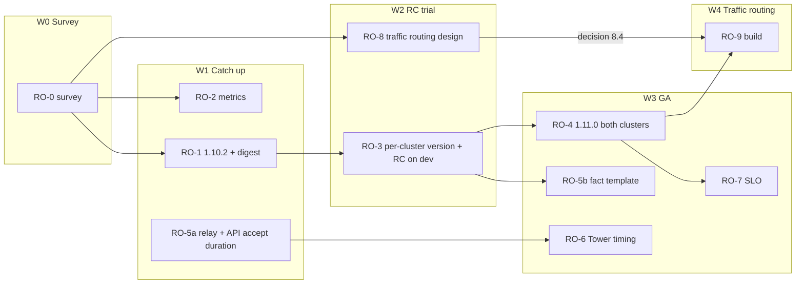

2026-11-10 · James

Hangar runs Argo Rollouts **v1.9.1** on both clusters. This spec moves it to **1.10.2 now**, tries **1.11.0-rc1** on hangar-dev, and takes **1.11.0 at GA**. It also uses 1.11's new rollout-duration tracking in Glidepath's release record and in Tower. Traffic-weighted canaries are a separate track that needs a design pass and an owner decision before anything is built. Source: the [v1.11.0-rc1 release notes](https://github.com/argoproj/argo-rollouts/releases/tag/v1.11.0-rc1), published 2026-11-05. The blog post returns 403 to automated fetches, so it was not read.

## 1. How to use this spec {#how-to-use}

This spec is written for a managing Claude Code session that does the work by handing packages to subagents. Each package card in section 6 stands alone. It names its repos, its dependencies, what to build, how to prove it on the live clusters, and what only the user can do.

### The Strip Board

This program has its own Strip Board (linked at the top of this page). The managing agent reads it at the start of every turn. Every question for the owner is an `A` strip, every owner-only step a `Y` strip, every problem an `I` strip, every package a `W` strip, everything shipped a `C` strip, and every claim not yet proven an `R` strip. Chat stays short and names strip ids. Decisions 8.1 to 8.5 are seeded as `A-2` to `A-6` (`A-1` asks whether to start), decision 8.6 as `Y-2`, and the packages as `W-1` (RO-0) to `W-10` (RO-9). The protocol is `tools/spec-kit/STRIP-BOARD-PROTOCOL.md` in the hangar repo.

### Roles

| Role | Reads | Owns |
|---|---|---|
| Managing agent | Sections 1 to 5, 7 and 8 in full; each package card before delegating it | Sequencing (section 7), the apron render and gitops PRs, merges where authorized, live verification, memory and doc status, every hand-off to the user |
| Subagent | Its package card, section 1's rules, and the README, AGENTS.md and docs that the card names | One PR in one repo unless the card says otherwise, with tests and docs. Reports back a PR link, what was verified, and what was left out |
| User (platform owner) | The spec and the PR links | gitops-hangar-prod merges and every other hangar-prod mutation, gitsign commits, Backstage merges the classifier refuses, upstream issues or PRs to argoproj, and every decision in section 8 |

### Model per subagent

The managing agent sets the Agent tool's `model` on every subagent, chosen by the kind of work. A subagent never inherits the managing session's model.

| Work | Model | Agent `model` |
|---|---|---|
| Coding: re-vendoring manifests, chart and composition changes, relay or API changes, Tower UI, tests and docs written with the code, review-bot fixes, merging main into a branch | Sonnet 5.5 | `sonnet` |
| Research: read-only surveys of repos, clusters, release notes, upstream PRs, plugin docs and metrics; collecting evidence and digests | Haiku 5.5 | `haiku` |
| A card that is mostly design (RO-8) | Sonnet 5.5, with its research sub-steps given to Haiku | `sonnet` |

In practice:

- The model goes on the brief's first line (`Model: sonnet` or `Model: haiku`), so the choice is visible before launch.
- A resumed agent keeps the model it started with.
- Opus is used only if the owner asks for it on a package.
- If a Haiku research agent finds the task needs code changes, it stops and reports. It does not edit.

### Package card format

Every card has the same fields, so a subagent's brief is its card copied word for word plus section 1's rules.

- **Id and title.** `RO-n`.
- **Model.** `sonnet` or `haiku`.
- **Repos.** Where the PRs land.
- **Depends on.** Packages that must be merged, and live where the card says so, before this one starts.
- **Build.** The concrete deliverable.
- **Done when.** The acceptance tests. They always include one negative test and one live check with quoted evidence.
- **Rollout.** Which steps of the release chain (below) the package needs.
- **User steps.** What the agent cannot do and must hand over.

### Rules every subagent follows

1. Work in a fresh worktree from `origin/main`. Use `git -C <path>` and `gh --repo <owner/repo>` on every call. Never `git stash` on a shared checkout, never force-push, never skip signing. If a repo needs gitsign, stop and hand the commit to the user.
2. Never edit a gitops repo by hand. Change the apron template, then render. A render is committed only when its `git diff --stat` touches exactly the files the card expects.
3. glidepath-api is the CI/CD interface. Tower reads release duration from a glidepath-api endpoint, never from the relay or a ConfigMap through the Kubernetes proxy. Rollout and AnalysisRun reads stay on the Kubernetes proxy (they are not CI/CD).
4. Tower's control taxonomy (filter, action, link, status) does not change. Duration is **status**. Any new button gets `onMouseDown={preventFocusScroll}`.
5. Every image and plugin binary must ship for both amd64 and arm64.
6. Docs change in the same PR as the code: apron's README for the component, glidepath `docs/admin/adr/0021-*` and `multi-cluster.md`, airframe chart docs, and Tower docs.
7. Run the repo's full test suite and read `gh pr checks` and the review bot's comment (Qodo, which replaced PR Lens on 2026-11-16) before reporting a PR ready. A merge needs every check green. Never chain a merge after a checks command.
8. "No errors" is not evidence. A live check quotes a command and its output: a controller image, a Rollout phase, a relay log line, an API response.
9. The final report names what was descoped and why, next to what was done.

### The release chain

The managing agent runs these steps one command at a time, never joined with `;` or `&&`:

1. The apron PR merges once every check is green.
2. Render `gitops-hangar-dev` over a clean `git archive origin/main` export (`python3 hack/render.py --cluster <c>/cluster.yaml --out <c> --apron-root <apron>`), then diff. The gitops PR touches only the expected paths. Merge it.
3. Watch the `argo-rollouts` Application sync on hangar-dev. Confirm the controller image, that the pod is Ready, and the CRD version (`kubectl get crd rollouts.argoproj.io -o jsonpath='{.metadata.annotations}'`).
4. Run the card's live checks on hangar-dev. Soak until each dev app has had one real release, or a check-ride run, under the new controller.
5. Render `gitops-hangar-prod` the same way and open the PR. **The user merges it.** Then repeat steps 3 and 4 on hangar-prod. Backstage itself is a Rollout on hangar-prod, so check Tower loads.
6. Record the evidence in memory (`project_argo_rollouts_1_11_eval.md`) and in apron's component README.

Glidepath and Tower packages add their own tail. Glidepath: tag, then the catalog and relay image pin in apron. Tower: tag, then the backstage pin bump. Run `yarn tsc` from a clean cache before the backstage merge.

### The done bar

A package is done when:

- its PRs are merged;
- its versions are live on every cluster the card names;
- its positive and negative tests passed against the live cluster, with the evidence quoted;
- its docs are updated.

Status words follow Hangar: **Built** (exists and tested), **Draft** (written, never applied), **Proposal** (designed, not written), **Unverified** (depends on something not checked).

## 2. Hangar context {#hangar-context}

| Part | Role in this work |
|---|---|
| **apron** | Vendors the Rollouts install manifest at `templates/10-crds-operators/argo-rollouts/` (directory source, `ServerSideApply=true`). It also owns the notifications ConfigMap that sends ADR-0021 facts to `glidepath-relay`. |
| **Airframe** | `airframe-application` renders every app's `Rollout` (canary by default, blueGreen optional, `rollbackWindow: {revisions: 3}`), Services, an optional Gateway API `HTTPRoute`, and the `hangar.io/release-tracked=true` label that subscribes a Rollout to facts. It also owns 7 Prometheus ClusterAnalysisTemplates (`airframe/analysis/`) and the RolloutWatch / HolmesGPT diagnosis composition. |
| **Glidepath** | `glidepath-relay` (`glidepath/broker/cmd/glidepath-relay/facts.go`, `reducer.go`) turns facts into release CDEvents and the release record. glidepath-api (`api/internal/releases`) serves releases to Tower. ADR-0021 phase 4 rollback relies on `rollbackWindow`. |
| **Tower** | Reads Rollout status through the Kubernetes proxy (`types.ts`, `CanaryRampChart.tsx`, `tabs/deployments/StageDetail.tsx`, `fleet/opsWallModel.ts`). It reads release records from glidepath-api (`useReleaseRecords.ts`) and controls Rollouts with a scoped `patch` on `rollouts.argoproj.io`. |
| **Clearance** | Not changed by this work. Prod gitops changes may pass through the G-ARGO gate on hangar-prod; RO-0 confirms whether `10-crds-operators` apps are covered. |

## 3. Current state as built (verified live 2026-11-10) {#current-state}

| Item | State | Evidence |
|---|---|---|
| Controller on hangar-dev | `quay.io/argoproj/argo-rollouts:v1.9.1` | `kubectl -n argo-rollouts get deploy` |
| Controller on hangar-prod | `quay.io/argoproj/argo-rollouts:v1.9.1` | same |
| Rollouts on hangar-dev | baggage, boarding (dev and pr-55), checkin, flight, gate | `kubectl get rollouts -A` |
| Rollouts on hangar-prod | backstage (prod), boarding, flight, gate (prod), gate (staging) | same |
| Upstream | 1.10.2 latest stable; 1.9.3 patch; 1.11.0-rc1 pre-release (all 2026-11-04 or 05) | `gh release list --repo argoproj/argo-rollouts` |
| Image pin | Tag only, no digest | `install.yaml` |
| Dashboard | Not deployed (1 Deployment in the manifest) | `install.yaml` |
| Analysis providers | All 7 ClusterAnalysisTemplates use `prometheus` at `kube-prometheus-stack-prometheus.observability:9090`; no `web:` provider in any Hangar repo | grep over `/Users/jerf/tech` |
| Traffic routing | None. `setWeight` only sets the pod ratio (`setWeight: 10` at replicas 2 sends about 50% of traffic) | `rollout.yaml` |
| Ingress | Gateway API `HTTPRoute` (optional per app) | `templates/networking/httproute.yaml` |
| Controller metrics | `argo-rollouts-metrics` Service exists; no ServiceMonitor for it in apron | **Unverified** whether anything scrapes it |
| Facts | 5 triggers, each gated on `observedGeneration == generation`; heartbeat every 15 min; `fact-degraded` de-duplicates on `status.message` | `notifications-configmap.yaml` |
| Tower canary weight | Derived on the client from `currentStepIndex` and the step list | `tower/src/types.ts:289` |

## 4. What 1.9.1 → 1.11 changes for Hangar {#what-changes}

| Change | Version | Impact | Package |
|---|---|---|---|
| Notifications panic fix for Unstructured writes ([#4844](https://github.com/argoproj/argo-rollouts/pull/4844)) | 1.10.0 | Hangar's facts depend on notifications | RO-1 |
| Abort syncs the desired-replicas annotation ([#4919](https://github.com/argoproj/argo-rollouts/pull/4919)); skips needless ephemeral-metadata pod listing ([#4951](https://github.com/argoproj/argo-rollouts/pull/4951)) | 1.10.0 | Abort correctness; controller load on the laptop-hosted prod | RO-1 |
| **Breaking:** the dashboard binds to 127.0.0.1 | 1.11 | None (not deployed) | RO-0 re-checks |
| **Breaking:** the web provider evaluates its conditions on empty and non-JSON bodies | 1.11 | None today; tenants can pass their own analysis through `rollout.canaryAnalysis` | RO-0 re-checks |
| **Rollout duration tracking** ([#4774](https://github.com/argoproj/argo-rollouts/pull/4774)): `status.duration.{rolloutStartedAt, manualPauseStartedAt, totalManualPauseDurationSeconds, finishedAt, completionStatus}`; histograms `rollout_duration_seconds`, `rollout_progression_duration_seconds` and `rollout_manual_pause_duration_seconds`, labelled only by `status` | 1.11 | Per-release timing goes through facts; the histograms give only fleet-wide totals | RO-2, RO-5, RO-6 |
| Canary and blueGreen reconcile moved onto a stage pipeline ([#5079](https://github.com/argoproj/argo-rollouts/pull/5079)) | 1.11 | **The main risk.** The relay reducer and Tower read `phase`, `message` and `currentStepIndex`; `fact-degraded` de-duplicates on `message` | RO-3 |
| Notification templates can read `.context` ([#5132](https://github.com/argoproj/argo-rollouts/pull/5132)) | 1.11 | Could replace `@@CLUSTER_NAME@@` in the fact path | Later |
| Abort shifts traffic to stable before scale-down ([#4900](https://github.com/argoproj/argo-rollouts/pull/4900)); `maxTrafficWeight` validation ([#4924](https://github.com/argoproj/argo-rollouts/pull/4924), [#4923](https://github.com/argoproj/argo-rollouts/pull/4923)) | 1.11 | Applies only once traffic routing exists | RO-8, RO-9 |
| Prometheus basic and Google auth; `secretKeyRef` across namespaces ([#4648](https://github.com/argoproj/argo-rollouts/pull/4648)) | 1.11 | Not needed while analysis queries an in-cluster, unauthenticated Prometheus | none |
| CI on Kubernetes 1.37; Go 1.26.10 | 1.11 | Note for cluster upgrades | none |

## 5. Gap analysis {#gap-analysis}

| Gap | Why it matters | Package |
|---|---|---|
| Two minor versions behind | Misses the notifications and abort fixes; a bigger jump later | RO-1 |
| Image pinned by tag | A re-tag would change prod without a commit | RO-1 |
| One apron template for both clusters | Cannot trial a version on hangar-dev alone | RO-3 |
| Controller metrics may be unscraped | No fleet view of rollouts; the 1.11 histograms would go nowhere | RO-2 |
| Release record has no timing | No split between time progressing and time waiting on approval; no deploy-duration SLO | RO-5, RO-6 |
| Canary weight is a pod ratio | Analysis at "10%" sees about half the traffic | RO-8, RO-9 |
| Controller refactor untested against facts | A silent change in phase or message would mis-report releases | RO-3 |

## 6. Work packages {#work-packages}

### RO-0 · Pre-upgrade survey
<!-- pkg status=not-started wave=W0 strip=W-1 -->

- **Model.** `haiku`
- **Repos.** None for the survey itself (read only). Writes `specs/plans/REPORT-argo-rollouts-survey-2026-11.md` in the hangar repo, by pull request.
- **Depends on.** Nothing.
- **Build.** A report that answers each of these with the command and output:
    1. Any `web:` provider, dashboard Deployment, or `kubectl argo rollouts dashboard` use across apron, airframe, every `gitops-*` and `*-tenants` repo, and the tenant `envs/*.yaml`.
    2. The full CRD and RBAC diff between the v1.9.1, v1.10.2 and v1.11.0-rc1 `install.yaml` release assets, plus the sha256 of each.
    3. Whether anything scrapes `argo-rollouts-metrics` on each cluster (`up{job=~".*rollouts.*"}` in Prometheus), and whether a NetworkPolicy blocks it.
    4. Whether the Clearance G-ARGO gate on hangar-prod covers the `argo-rollouts` Application, and what a gitops-hangar-prod change to it needs.
    5. The multi-arch index digest for `quay.io/argoproj/argo-rollouts` at v1.10.2 and v1.11.0-rc1.
    6. The Gateway API implementation and version behind `hangar-gateway` on each cluster, and whether it supports weighted `backendRefs` (for RO-8).
- **Done when.** Every question has quoted evidence or is marked Unverified with the reason. Negative check: the grep in item 1 is run against a fixture file known to contain `web:`, which proves it would match.
- **Rollout.** None.
- **User steps.** None.

### RO-1 · Upgrade to 1.10.2, pinned by digest
<!-- pkg status=not-started wave=W1 strip=W-2 depends=RO-0 -->

- **Model.** `sonnet`
- **Repos.** apron, then gitops-hangar-dev and gitops-hangar-prod through the render.
- **Depends on.** RO-0.
- **Build.**
    - Re-vendor `install.yaml` from the v1.10.2 release asset. Check its sha256 against RO-0 and record it in the `application.yaml` header comment, which currently names v1.9.1.
    - Rewrite the controller image to `quay.io/argoproj/argo-rollouts:v1.10.2@sha256:<index digest>`. Add a check in `hack/check.py` that the image carries a digest.
    - Update the component README with the version, the upgrade steps, and the rule that the notifications ConfigMap is Hangar's and is not part of the vendored file.
- **Done when.**
    - Both clusters run v1.10.2 at the pinned digest, and every Rollout listed in section 3 is Healthy.
    - On hangar-dev, a real release of one app walks its canary steps and its AnalysisRun succeeds. `glidepath-relay` logs Progressing, Paused and Healthy facts for that release-id, each once. Tower's canary ramp shows the steps.
    - Negative test: a scratch release whose analysis is forced to fail (an arg that makes `success-rate-check` fail) auto-aborts. The relay logs a Degraded fact with `abort: true`, and the release record shows the failure.
    - The `rollbackWindow` fast-track still skips the steps on a revert.
- **Rollout.** Release chain steps 1 to 6.
- **User steps.** Merge the gitops-hangar-prod PR.

### RO-2 · Controller metrics scraped
<!-- pkg status=not-started wave=W1 strip=W-3 depends=RO-0 -->

- **Model.** `sonnet`
- **Repos.** apron (`40-observability` or the argo-rollouts component).
- **Depends on.** RO-0, item 3. Skip this card if RO-0 shows the metrics are already scraped on both clusters.
- **Build.** A ServiceMonitor for `argo-rollouts-metrics` and any NetworkPolicy allowance it needs, rendered for both clusters. Use the label the kube-prometheus-stack selector expects.
- **Done when.** `up{service="argo-rollouts-metrics"} == 1` on both clusters, and `rollout_info` returns one series per Rollout in section 3. Negative test: the query for a Rollout that does not exist returns empty.
- **Rollout.** Release chain steps 1 to 6.
- **User steps.** Merge the gitops-hangar-prod PR.

### RO-3 · Per-cluster version and the 1.11 RC trial on hangar-dev
<!-- pkg status=not-started wave=W2 strip=W-4 depends=RO-1 -->

- **Model.** `sonnet`
- **Repos.** apron, gitops-hangar-dev.
- **Depends on.** RO-1 live on both clusters. Decision 8.1.
- **Build.**
    - Vendor each version in its own subdirectory (`argo-rollouts/v1.10.2/`, `argo-rollouts/v1.11.0-rc1/`). Add a `cluster.yaml` value (`components.argoRollouts.version`) that the render uses to pick the `path`. Default to the stable version. Set hangar-dev to the RC.
    - Record a baseline from RO-1's soak first: fact counts per release-id and phase from the relay log.
- **Done when.** On hangar-dev under the RC, across at least one release of each dev app:
    - every phase fact arrives once per release (counts match the 1.10.2 baseline);
    - `fact-degraded` does not repeat for one failure;
    - `fact-heartbeat` stays one POST per Rollout per 15 minutes;
    - `rollbackWindow` fast-track skips the steps;
    - Tower's step graph and ramp are correct;
    - `status.duration` is populated, and `completionStatus` is right for a success and for an abort.

    Negative test: the RO-1 forced-failure release aborts and reports Degraded once. hangar-prod's render does not change (diff is empty).
- **Rollout.** Release chain steps 1 to 4 (hangar-dev only).
- **User steps.** Any upstream issue for a regression found here is filed by the user. The agent drafts it.

### RO-4 · Upgrade to 1.11.0 GA
<!-- pkg status=not-started wave=W3 strip=W-5 depends=RO-3 -->

- **Model.** `sonnet`
- **Repos.** apron, then both gitops repos.
- **Depends on.** 1.11.0 GA published; RO-3's checks passed on the RC. Re-read the GA release notes for anything new since rc1.
- **Build.** Vendor v1.11.0 by digest as in RO-1. Point both clusters at it. Remove the RC directory. Re-run RO-0 item 1 (the breaking-change greps) on the day.
- **Done when.** RO-1's checks pass on both clusters under v1.11.0. The CRD carries `status.duration` (`kubectl explain rollout.status.duration`). Tower loads on hangar-prod (Backstage is itself a Rollout).
- **Rollout.** Release chain steps 1 to 6.
- **User steps.** Merge the gitops-hangar-prod PR.

### RO-5 · Rollout duration in the release facts and record
<!-- pkg status=not-started wave=W1-W3 strip=W-6 depends=RO-3,RO-4 -->

- **Model.** `sonnet`
- **Repos.** glidepath (relay, release record, glidepath-api, ADR-0021 docs), then apron (fact template).
- **Depends on.** RO-5a: nothing. RO-5b: RO-3 on hangar-dev; RO-4 before it reaches prod.
- **Build.**
    - **RO-5a (glidepath).** Add an optional `status.duration` to the relay's `fact` struct. Carry `startedAt`, `finishedAt`, `manualPauseSeconds` and `completionStatus` into the emission and the CDEvent. Store them on the release record and expose them on the glidepath-api releases endpoint, with the contract regenerated. An absent field gives null, so this lands before any controller change. Amend ADR-0021 with a short section.
    - **RO-5b (apron).** Add `"duration":{{toJson .rollout.status.duration}}` to `template.fact`. Keep the triggers and `oncePer` keys unchanged.
- **Done when.**
    - Unit tests cover a fact with duration, without it, and with an aborted `completionStatus`.
    - On hangar-dev, a release's record from glidepath-api shows all four fields. Quote the curl output. Progression time equals total time minus manual-pause time, within 2 s.
    - Negative test: a fact from a 1.10.2 cluster (no field) is still accepted, and its record shows nulls rather than zeros.
- **Rollout.** A Glidepath tag, then the relay image and catalog pin in apron and the release chain; the apron fact template follows.
- **User steps.** None expected.

### RO-6 · Tower shows release timing
<!-- pkg status=not-started wave=W3 strip=W-7 depends=RO-5,RO-2 -->

- **Model.** `sonnet`
- **Repos.** tower, then backstage (pin bump).
- **Depends on.** RO-5a live; RO-2 for the fleet panel.
- **Build.**
    - The release record row and the deployment stage detail show total, progressing, and waiting-on-approval times (status controls). Values come from glidepath-api only.
    - The Ops Wall gets a fleet p50 and p95 of `rollout_duration_seconds` by `status`, read through Tower's existing Prometheus path.
    - Empty states: "not recorded" for releases from before 1.11.
- **Done when.**
    - Jest and `yarn tsc` from a clean cache pass.
    - In the local Backstage harness and then on hangar-prod's Backstage, a real dev release shows its three durations, matching the glidepath-api response. Take screenshots.
    - Negative test: a pre-1.11 release shows "not recorded", not "0s".
- **Rollout.** Tower tag, then the backstage pin bump.
- **User steps.** Merge the backstage PR if the classifier refuses.

### RO-7 · Deploy-duration SLO
<!-- pkg status=not-started wave=W3 strip=W-8 depends=RO-2,RO-4 -->

- **Model.** `sonnet`
- **Repos.** apron (Sloth or recording rules), hangar docs.
- **Depends on.** RO-2 and RO-4 live.
- **Build.** A recording rule and SLO on `rollout_progression_duration_seconds` (fleet-wide; the metric has no per-app label). The target is set by decision 8.5. Record the measured baseline first.
- **Done when.** The SLO renders and evaluates on both clusters, with its current value quoted. Negative test: an alert test with a synthetic slow series fires.
- **Rollout.** Release chain steps 1 to 6.
- **User steps.** Set the target (8.5).

### RO-8 · Traffic routing design pass
<!-- pkg status=not-started wave=W2 strip=W-9 depends=RO-0 -->

- **Model.** `sonnet`. Research steps go to `haiku`.
- **Repos.** A design doc in hangar docs, or `airframe/docs/`.
- **Depends on.** RO-0 item 6. Can run alongside RO-3.
- **Build.** A design, plus a spike on hangar-dev with one scratch app, for weighted canaries through Gateway API using `argoproj-labs/rollouts-plugin-trafficrouter-gatewayapi`. It answers:
    - **Plugin loading.** `trafficRouterPlugins` in `argo-rollouts-config` downloads a binary at controller start. It needs a sha256 pin, a mirror Hangar controls, multi-arch builds, and a plan for egress at startup.
    - **Gateway support.** Whether `hangar-gateway`'s implementation honours weighted `backendRefs` on an HTTPRoute.
    - **Chart changes.** Canary and stable Services in `airframe-application`, and an opt-in `rollout.trafficRouting.gatewayAPI` that is off by default.
    - **Analysis.** Whether the Traefik-metric analysis queries still select the right series per Service.
    - **Tower.** Showing `status.canary.weights` in place of the derived weight.
    - **Abort.** How 1.11's abort traffic-shift fix (#4900) behaves.
- **Done when.** The spike shows a measured traffic split, not a pod ratio. At `setWeight: 10` with replicas 2, about 10% of 1,000 requests reach the canary; quote the counts. Negative test: abort returns 100% to stable before scale-down. The doc ends with a recommendation for decision 8.4.
- **Rollout.** None (the spike is removed afterwards).
- **User steps.** Decision 8.4.

### RO-9 · Traffic routing build
<!-- pkg status=not-started wave=W4 strip=W-10 depends=RO-8,RO-4 -->

- **Model.** `sonnet`
- **Repos.** airframe (chart, XRD or composition fields, docs), apron (plugin config), tower.
- **Depends on.** RO-8 and decision 8.4 = adopt; RO-4 live.
- **Build.** What RO-8 decides, opt-in per app, with boarding-api first.
- **Done when.** RO-8's split test passes on boarding-api in dev, then in prod. Tower shows the real weights. Apps that have not opted in render unchanged (empty render diff).
- **Rollout.** Airframe release, apron render, release chain.
- **User steps.** Merge the gitops-hangar-prod PR; turn it on for each prod app.

### Later in this series

- Use `.context` (#5132) to carry the cluster name in the fact template in place of the `@@CLUSTER_NAME@@` substitution. The value is low; do it only if the render substitution causes trouble.
- Move the analysis Prometheus address to Thanos Query with basic auth (1.11) if analysis ever needs cross-cluster data.

## 7. Sequencing {#sequencing}

| Wave | Packages | Starts when | Gate at the end |
|---|---|---|---|
| W0 Survey | RO-0 | Now | Survey report with no blocking finding |
| W1 Catch up | RO-1, RO-2, RO-5a in parallel | W0 done | 1.10.2 live on both clusters with RO-1's checks quoted; glidepath-api accepts and serves duration fields (null) |
| W2 RC trial | RO-3; RO-8 in parallel | W1 gate passed; decision 8.1 | RC regression report: facts match the baseline; RO-8 recommendation written |
| W3 GA | RO-4, then RO-5b, RO-6, RO-7 | 1.11.0 GA published and W2 gate passed | A hangar-prod release record shows its three durations in Tower |
| W4 Traffic routing | RO-9 | Decision 8.4 = adopt | A measured 10% split on boarding-api in prod |

The managing agent may run W1's three packages as parallel subagents. RO-5a touches only Glidepath and is safe ahead of any controller change.

## 8. Decisions for the owner {#decisions}

1. **Trial the RC on hangar-dev (RO-3) or wait for GA.** Recommended: trial it, because hangar-dev is a lab, and the stage-pipeline refactor is exactly what a facts-heavy setup should test before GA.
2. **Per-cluster Rollouts version in apron (RO-3).** Recommended: yes. It turns every later upgrade into dev first, then prod, with one value.
3. **Pin the controller by digest (RO-1).** Recommended: yes, as is already done for Clearance images.
4. **Adopt Gateway API traffic routing (RO-9).** Decided after RO-8's spike. The open costs are a downloaded plugin binary in the controller, and Services and an HTTPRoute shape that change for opted-in apps.
5. **Deploy-duration SLO target (RO-7).** Set after the baseline is measured.
6. **Upstream reports.** Any RC regression goes to argoproj as an issue filed by the owner. Agents draft it and never post it.
